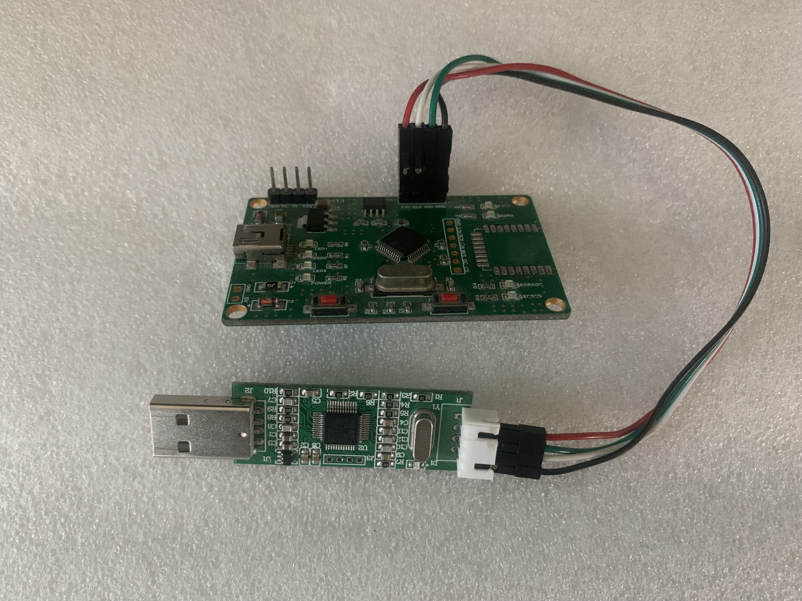

# STM32F103C8T6_CMSIS-DAP
-----------------------------

Based x893's code on: https://github.com/x893/CMSIS-DAP

My contribution:

1. Upgrade CMSIS-DAP version to V2.0.0 (HID mode, not WinUSB).
2. Enable SWO_UART function(USART1), no SWO_STREAM/SWO_MANCHESTER mode.
3. CDC function improved(USART2).
4. Added a Soft-Reset function for Cortex-M.
5. Added BluePill board support, Remapped or unRemap (refer to Docs).
6. Added STLINK_V2A, STLINK_V2B board support (refer to Docs).
7. Added JLINK_OB board support (refer to Docs).
8. Fixed USB ESOF interrupt lockup issue.
9. Minor changes, e.g. LED handling, project files re-group......

---

## JLINK_OB Board Support

### Hardware Features
- **Target MCU**: STM32F103C8T6 (72MHz)
- **Interface**: SWD only (JTAG disabled)
- **SWO**: **Not supported** (no hardware TDO/SWO pin)
- **Reset**: Software reset via NVIC_SystemReset() (no hardware nRESET pin)
- **LED**: Single shared LED on PB12 (low active) for both Connected/Running status
- **USB**: Full-speed device (USB_DP/PA12, USB_DM/PA11, USB_PULLUP/PA9)

### Pin Configuration (JLINK_OB)

| Function | Port | Pin | Notes |
|----------|------|-----|-------|
| SWDIO / TMS | GPIOA | PA7 | SWD Data |
| SWCLK / TCK | GPIOA | PA5 | SWD Clock |
| TDI | - | NC | Not used (SWD mode) |
| TDO / SWO | - | NC | **Not supported (no hardware pin)** |
| nRESET | - | NC | Software reset only (NVIC_SystemReset) |
| USB_DP | GPIOA | PA12 | USB D+ (hardware fixed) |
| USB_DM | GPIOA | PA11 | USB D- (hardware fixed) |
| USB_PULLUP | GPIOA | PA9 | USB pull-up control (active high) |
| LED (Shared) | GPIOB | PB12 | Low active, shared Connected/Running |
| TDI | - | NC | Not used (SWD mode) |
| nTRST | - | NC | Not used (SWD mode) |

### JLINK_OB Board Photo



### Key Fixes for JLINK_OB

1. **USB ESOF Interrupt Lockup Fix**
   - Disabled `CNTR_ESOFM` interrupt mask in `USBD_Reset()` to prevent ESOF interrupt storm lockup
   - Removed ESOF interrupt handler from USB ISR

2. **USB Error Reset Fix**
   - `USBD_Error_Event()` no longer calls `HardFault_Handler()` for JLINK_OB
   - Prevents unexpected system reset on USB errors (CRC, bit stuffing, etc.)

3. **Shared LED Pin Fix (PB12)**
   - Connected LED and Running LED share PB12
   - `SysTick_Handler` only maintains time base for JLINK_OB
   - Heartbeat LED toggling moved to main loop (`LedRunningToggle()`)

3. **LED Control Functions Protected**
   - `LedConnectedOut()` / `LedRunningOut()` do nothing for JLINK_OB
   - Prevents host LED commands from interfering with heartbeat

### Compilation
Define `JLINK_OB` in project options to enable this configuration.

```c
#define JLINK_OB
```

---

## Board Comparison

| Feature | BluePill | STLINK_V2A/V2B | JLINK_OB |
|---------|----------|----------------|----------|
| SWD | ✅ | ✅ | ✅ |
| JTAG | ✅ | ✅ | ❌ (SWD only) |
| SWO | ✅ | ✅ | ✅ (PB7/PA10) |
| nRESET | PB6 | PB14/PA15 | Software only |
| LED | PC13 | PA9 | PB12 (shared) |
| USB | PA11/PA12 | PA11/PA12 | PA11/PA12 |

---

## Board Schematics & Pin Configs

- [BluePill Remapped SWD](Doc/Bluepill/1.SWD_Remapped.jpg)
- [BluePill UnRemapped SWD](Doc/Bluepill/2.SWD_unRemap.jpg)
- [BluePill Pin Config](Doc/Bluepill/Bluepill CMSIS-DAP Pin-config.txt)
- [STLINK_V2A/V2B Schematics](Doc/STLINK_V2A_V2B/)
- JLINK_OB pin config defined in `CMSIS-DAP/DAP_config.h` (search for `JLINK_OB`)

---

## Other Repositories

Check my another repository for USB2.0 High-Speed CMSIS-DAP device:
- [CMSIS-DAP_for_STLINK-V3MINI](https://github.com/RadioOperator/CMSIS-DAP_for_STLINK-V3MINI)

---

## License

Based on ARM CMSIS-DAP (Apache-2.0) and x893's implementation.